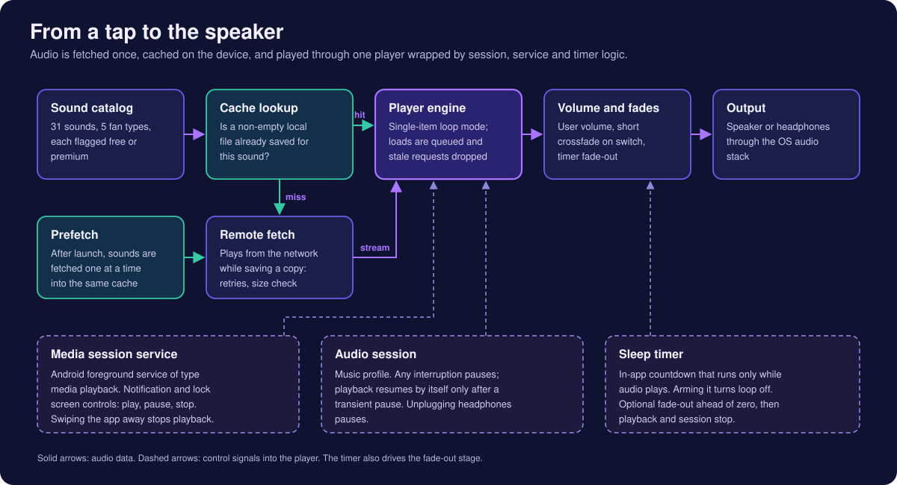
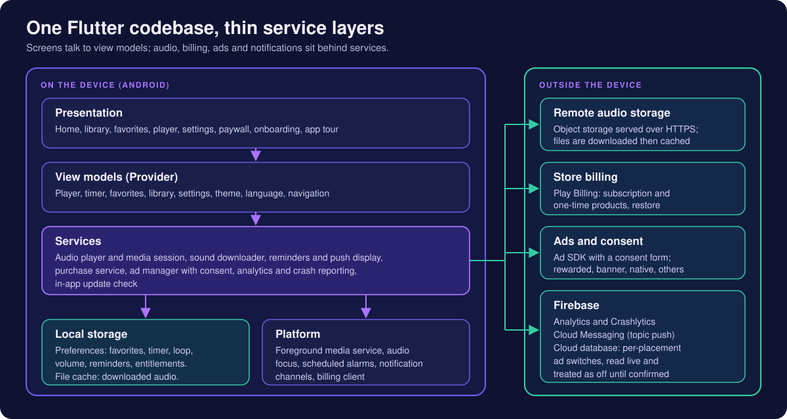
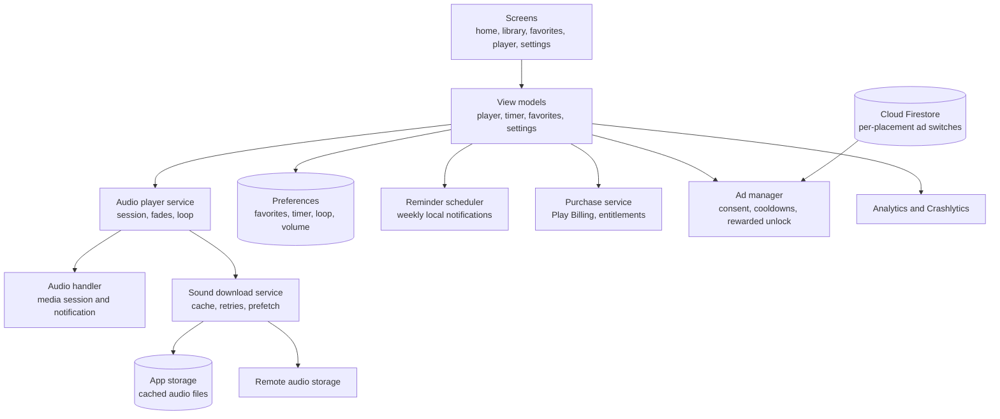

# QuietFan

**A fan and appliance sound player for Android: 31 looping fan sounds, a media-session player with notification controls, a sleep timer with fade-out, favorites, a bedtime reminder, and an audio cache that downloads once and then plays from the device.**

**Android (Google Play)** 
Flutter · Dart · Provider · just_audio · audio_service · Firebase

<table>
  <tr>
    <td align="center"></td>
    <td align="center"></td>
    <td align="center"></td>
  </tr>
</table>
Real screenshots from the Android build, cropped to the app content (system status bar and ad-placeholder strips removed), captured with sample/placeholder data, metadata removed. The app calls itself "Fan Sounds" on screen.

---

## Get the App

  

QuietFan is an audio utility: it plays steady fan, ventilation and air-purifier recordings on a loop. This portfolio describes the engineering only and makes no claims about sleep, health or other outcomes. Some in-app labels use sleep wording; they are the app's own copy, not statements made here.

## Platforms

The released app is **Android only**, distributed through Google Play. The Flutter project also carries iOS configuration (a background-audio mode, a tracking-consent prompt, a store test configuration), but the app has no App Store listing and nothing in this repository claims an iOS release.

## The Idea in One Picture

The product is one long-running audio session, so most of the engineering is about keeping that session alive, controllable and polite: a cache that makes playback independent of the network, one player instance wrapped by a media session, and a timer that can end the session without a jarring cut.

  

## Product at a Glance

| | |
|---|---|
| **What it is** | A looping fan-sound player with five fan categories: box, ceiling, desk, stand and air purifier |
| **Catalog** | 31 sounds, each flagged free or premium (counted from the catalog definition) |
| **Playback** | Loop per sound, volume, previous and next within a fan type, a seekable progress bar when not looping |
| **Sleep timer** | Preset durations from 15 minutes to 2 hours, a default-timer setting, optional fade-out before the end |
| **Background use** | Foreground media-playback service with notification and lock-screen controls; stops when the app is swiped away |
| **Favorites** | A saved list of sounds with its own tab, stored on the device |
| **Reminder** | An optional weekly bedtime notification on chosen days and time |
| **Offline** | Sounds are downloaded in the background and cached; a cached sound plays without a connection |
| **Languages** | Seven selectable in-app languages through bundled string tables |
| **Business model** | Free tier with ads; premium sounds unlocked by a store subscription, by one-time products, or temporarily after a rewarded ad |
| **Services** | Firebase (Analytics, Crashlytics, Cloud Messaging, Cloud Firestore), Google Play Billing, an ad SDK with a consent form, Play in-app updates |
| **Code size** | 96 hand-written Dart files and about 18.6k lines under the app source folder (a count, including about 1.9k lines of language tables), plus one widget test |

## Walkthrough

<table>
  <tr>
    <td align="center"> <b>Home</b> A featured card with play and favorite buttons, a fan-type carousel, a short list of free sounds, and a persistent mini player above the tab bar</td>
    <td align="center"> <b>Now Playing</b> Transport buttons, a Loop toggle, a Volume sheet and a Sleep timer selector, with favorite and share actions in the header</td>
    <td align="center"> <b>Sounds library</b> Filter chips per fan type; rows show a favorite heart and a play button, or a lock for premium sounds</td>
  </tr>
  <tr>
    <td align="center"> <b>Favorites (empty state)</b> The tab before any sound has been saved</td>
    <td align="center"> <b>Settings</b> Default sleep timer, fade-out switch, bedtime reminder, language and dark mode</td>
    <td></td>
  </tr>
</table>

## Design Choices Worth Reading About

- **One player, one session.** A single player instance backs the screen, the mini player and the media notification, so the three can never disagree about what is playing.
- **The network is a first-load cost, not a playback dependency.** Audio is fetched over HTTPS once, written to the app's storage with a size check, and replayed from disk afterwards.
- **The UI says what the user asked for.** The view model tracks the user's intent separately from the engine's reported state, so a slow load or a late engine event cannot flip the play button the wrong way.
- **Polite to other audio.** Interruptions pause playback; unplugging headphones pauses it; the app's own tap clicks use a separate player that never takes audio focus.
- **Start-up never waits on plugins.** Only local preferences are awaited before the first frame; audio, billing, notifications, push and analytics are initialised afterwards, each in its own guarded step.

## Engineering Highlights

### A download-once audio cache with a streaming fallback
- **Problem:** the catalog is far larger than a sensible install size, but a sound that stutters on a weak connection is useless as a background utility.
- **Approach:** audio files live in remote object storage, not in the app package. Playback checks for a non-empty local copy first; on a miss it streams from the remote URL and starts a de-duplicated download in parallel. Downloads write to a temporary file, retry up to three times, verify the length against the response header, then rename into place. After launch, a background pass fetches every remaining sound one at a time with a short pause between files.
- **Outcome:** after the first fetch a sound plays from disk with no connection. A corrupt cached file is deleted, re-downloaded and replaced by a streamed source for that play. A Clear Storage screen lists downloaded audio with sizes and can remove it.

### A media session that behaves like a music app
- **Problem:** a sound meant to run for hours has to survive screen-off, app switching and the notification shade.
- **Approach:** an audio-handler layer exposes play, pause and stop through a foreground media-playback service, with compact notification actions, media-button toggling and a tap that returns to the player screen. Swiping the app out of recents stops playback and tears the session down.
- **Outcome:** lock-screen and notification controls work for the one sound that is loaded. Previous and next exist on the player screen only; the system session deliberately offers just play, pause and stop.

### Interruptions, headphones and fades
- **Problem:** calls, other apps and unplugged headphones all demand different responses.
- **Approach:** the audio session uses a music profile with the player's own interruption handling switched off, so the app decides. Any interruption pauses; playback resumes on its own only after a transient pause; unplugging headphones pauses and cancels any pending auto-resume. Switching sounds fades the old one out and the new one in over a short crossfade, with a token that cancels a fade the moment a newer request arrives.
- **Outcome:** no resume surprises after the user paused on purpose, and rapid taps cannot stack fades.

### Looping and the sleep timer as one state machine
- **Problem:** loop, timer and fade-out interact: a timer implies a finite session, a loop implies an endless one.
- **Approach:** loop uses the player's single-item loop mode and is remembered per sound. Arming a timer turns loop off; turning loop on disarms the timer. The countdown only advances while audio is playing and pauses with it. With fade-out enabled, volume ramps down over the last seconds, and at zero the player and the session stop together.
- **Outcome:** one coherent rule set instead of three independent toggles. Loop seamlessness comes from the source files and the platform player; this repository does not claim gapless playback.

### Ads and billing that cannot hang launch
- **Problem:** consent forms, ad SDK start-up and billing connections have unbounded latency.
- **Approach:** consent is gathered before the ad SDK starts, with timeouts at each step; each ad placement is controlled by a live switch document that is treated as off until a read succeeds; cooldowns apply per ad format; premium users skip ads. Billing keeps three entitlements, re-synced from the store's purchase history on launch, with restore support.
- **Outcome:** ad and billing failures degrade to "no ad" or "store unavailable" instead of blocking playback. No revenue or fill-rate claims are made.

More detail, trade-offs and what is not covered: [docs/ENGINEERING_CHALLENGES.md](docs/ENGINEERING_CHALLENGES.md).

## Architecture

  

More diagrams and component responsibilities: [docs/ARCHITECTURE.md](docs/ARCHITECTURE.md).

## Technology Stack

| Layer | Technology |
|---|---|
| App framework | Flutter / Dart, Android minimum API level 26 |
| State management | Provider with `ChangeNotifier` view models |
| Audio playback | `just_audio` for the player; `audio_service` for the media session and foreground service; `audio_session` for focus and interruption events |
| UI sounds | `audioplayers` for a short tap click on a separate, non-focus-taking player |
| Local storage | `shared_preferences` for settings, favorites, timer state and entitlements; the app documents directory for cached audio |
| Reminders | `flutter_local_notifications` with `timezone` for weekly scheduled reminders |
| Push and observability | Firebase Cloud Messaging (topic subscription), Firebase Analytics, Firebase Crashlytics |
| Remote switches | Cloud Firestore documents for per-placement ad switches |
| Billing | Google Play Billing through `in_app_purchase` |
| Ads | `google_mobile_ads` with the Google consent form |
| Updates | Play in-app updates (`in_app_update`) |
| Connectivity | `connectivity_plus` |
| Localisation | Bundled string tables for seven languages |
| Tests | One Flutter widget test (splash screen renders) |

## Honest Trade-offs

- **Entitlements are checked on the device.** Server-side verification of purchases is a natural next step.
- **The timer is an in-app countdown.** It counts seconds with a periodic ticker while the foreground service keeps the app process alive; an end-timestamp design would be more tolerant of delayed ticks.
- **The first play of an uncached sound needs a connection.** There is no audio bundled in the app package apart from a short UI click.
- **The media session is minimal.** Play, pause and stop only; no skip or seek from the notification.
- **Test coverage is thin.** There is one widget test; audio, download, timer, billing and ads logic have no automated tests.
- **Android is the only released platform.** The iOS project is configuration, not a shipped product.

## Documentation

| Read | For |
|---|---|
| [Product overview](docs/PRODUCT_OVERVIEW.md) | What the app does, screen by screen, free versus premium |
| [Technical case study](docs/TECHNICAL_CASE_STUDY.md) | End-to-end technical write-up of the audio stack |
| [Architecture](docs/ARCHITECTURE.md) | Diagrams and component responsibilities |
| [Engineering challenges](docs/ENGINEERING_CHALLENGES.md) | Problem, approach, trade-offs, outcome |
| [Privacy and source](docs/PRIVACY_AND_SOURCE.md) | What is and is not published |
| [Rights](RIGHTS.md) | Usage terms |

## Source Code

This repository is a portfolio showcase for a production application. Production source code is maintained privately. See [RIGHTS.md](RIGHTS.md) for usage terms.
