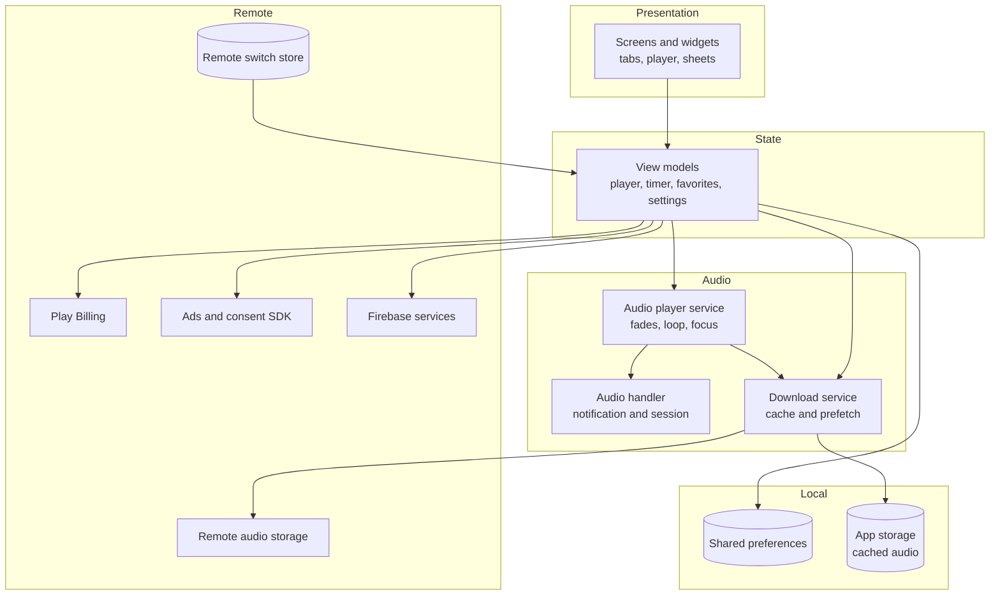
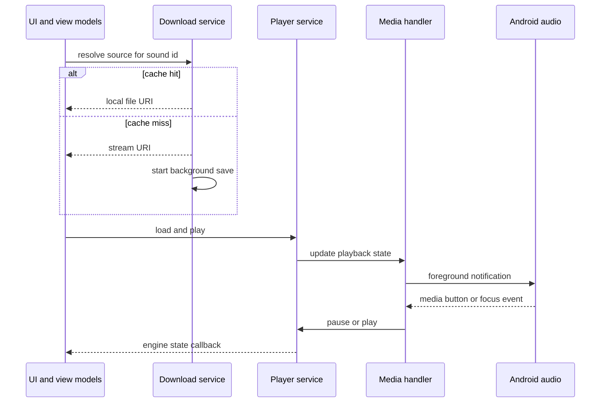

# Architecture

Diagram labels are conceptual and do not correspond to production identifiers.

## System overview

  

QuietFan is a single Flutter application targeting Android for release. Almost all logic runs on the device. Remote systems supply audio bytes, store purchases, advertisement inventory, analytics and crash reports, push topic delivery, and boolean switches that gate ad placements. There is no custom application backend for user accounts or sound metadata in the described design.

## Audio pipeline

  

A selected catalog entry flows through cache resolution, optional network fetch, the shared player engine, volume and fade stages, and the device audio output. Parallel control paths include the media session service, interruption handler and sleep timer notifier.

## Layered structure

| Layer | Responsibility |
|---|---|
| **Presentation** | Renders lists, featured cards, player chrome and settings. Hosts the mini player and routes deep links from notifications. |
| **View models** | Holds playback intent, timer state, favorites list and settings. Coordinates calls into services and persists user choices. |
| **Audio player service** | Owns the single `just_audio` instance, applies volume and crossfades, sets loop mode, reacts to focus events. |
| **Audio handler** | Bridges to `audio_service`: foreground notification, media button handling, play/pause/stop, artwork and metadata. |
| **Download service** | Maps catalog IDs to filesystem paths, orchestrates streaming fallback, retries, prefetch pacing and cache eviction UI data. |
| **Local stores** | Preferences for lightweight state; documents directory for large binary cache files. |
| **Integrations** | Billing client, ad manager with consent gating, Firebase analytics/crash/messaging, Firestore listener for switches, local notification scheduler. |

## Playback state flow

The view model merges engine callbacks with queued user actions so the UI reflects intent during loads and fades.

## Data kept on device

| Data | Store | Notes |
|---|---|---|
| Favorites list | Preferences | Ordered sound identifiers |
| Per-sound loop preference | Preferences | Restored when revisiting a sound |
| Volume and fade settings | Preferences | Includes default sleep timer and fade toggle |
| Entitlements and temp unlocks | Preferences | Updated from billing and rewarded callbacks |
| Cached audio files | App storage | Named per catalog entry; size shown in settings |
| Reminder schedule | Preferences plus OS alarm | Weekday set and local time |

No cloud sync of favorites or playback history is described in this portfolio.

## External dependencies

| Dependency | Role |
|---|---|
| Remote object storage | Hosts MP3 or similar assets addressed by HTTPS |
| Google Play Billing | Subscriptions and one-time products |
| Mobile ads SDK | Banner, interstitial and rewarded formats with consent |
| Firebase Analytics | Event telemetry configured in the app |
| Firebase Crashlytics | Uncaught error reports |
| Firebase Cloud Messaging | Topic subscription for broadcast messages |
| Cloud Firestore | Small documents toggling ad placements |
| Play in-app updates | Prompts when a newer binary is available |

Exact event names, collection paths and product SKUs are intentionally omitted from this repository.

## Platform notes

Minimum Android API level **26** is declared in the Flutter project. The iOS runner includes background audio mode and tracking transparency hooks, but no iOS store listing exists; architecture diagrams treat iOS as unreleased configuration only.

## Related reading

- [Technical case study](TECHNICAL_CASE_STUDY.md) — narrative walkthrough of the same stack
- [Engineering challenges](ENGINEERING_CHALLENGES.md) — problem-focused deep dives
- [Privacy and source](PRIVACY_AND_SOURCE.md) — what this repo does and does not publish
