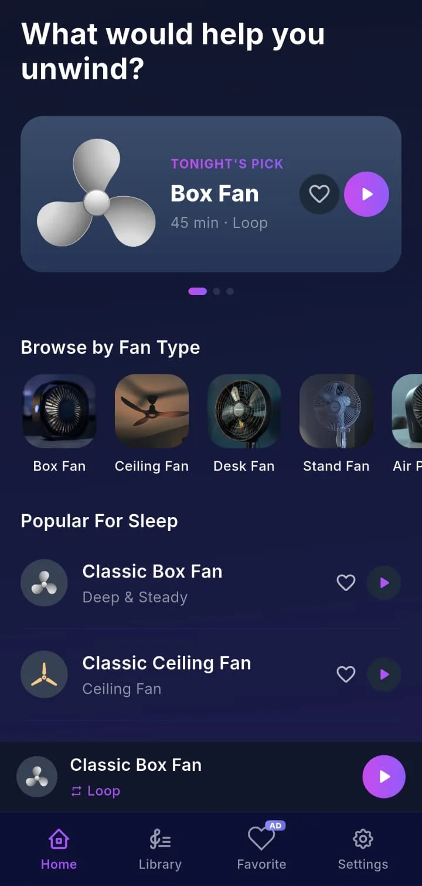
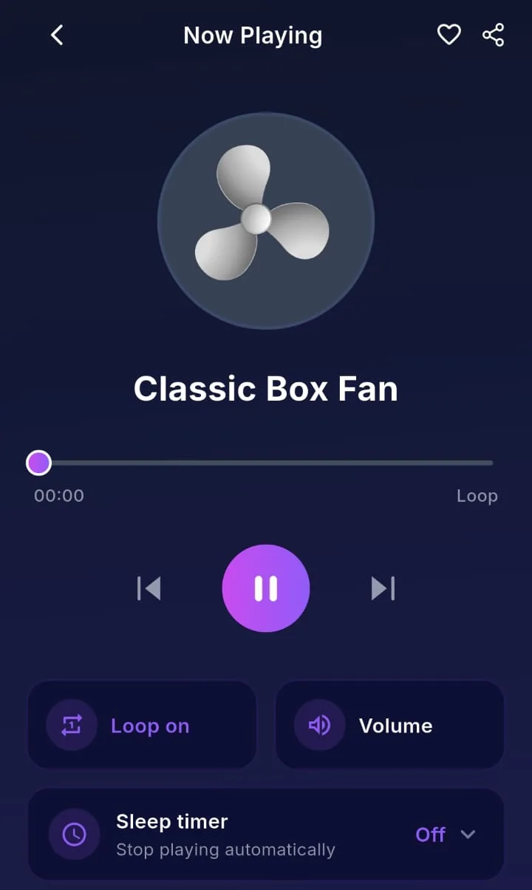
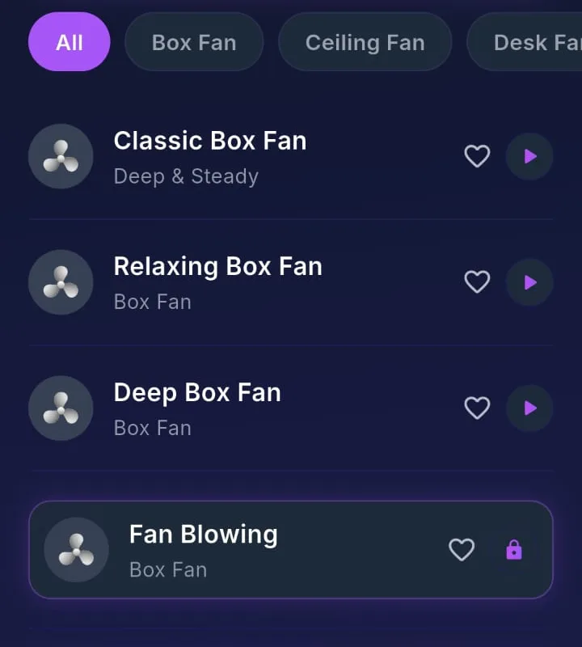
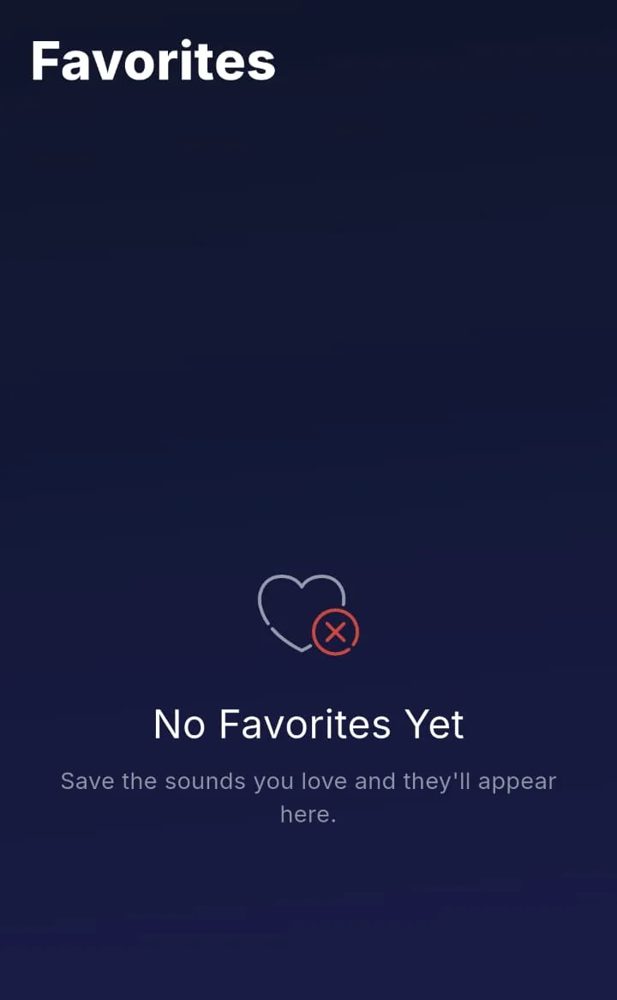
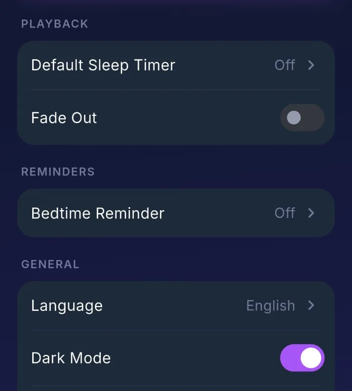

# Product Overview

All screenshots on this page are real captures from the Android build, cropped to the app content (system status bar and ad-placeholder strips removed), captured with sample and placeholder data, with metadata removed. On device the app title reads **Fan Sounds**; this portfolio uses the QuietFan name for the repository only.

## What it is

QuietFan is a looping sound player for Android. It plays steady recordings of fans, ventilation units and air purifiers so a person can listen in the background while using the phone for something else or with the screen off. The product is deliberately narrow: choose a sound, control volume and playback, optionally set a timer, save favorites and receive an optional weekly reminder. It is not a sleep tracker, not a noise-cancellation tool and not a medical or wellness product. This document describes behaviour only; it does not claim that listening improves sleep, focus or any other outcome. Some in-app strings use sleep-oriented wording; those labels are the app's own copy, not statements made in this repository.

## Positioning

| Topic | Stance in this portfolio |
|---|---|
| Health and sleep | No outcome claims. The sleep timer stops playback after a chosen duration; it does not track sleep stages or quality. |
| Audio quality | Sounds are pre-recorded loops. Seamless looping depends on the source files and the platform player; gapless playback is not claimed here. |
| Offline use | After a sound is cached on the device it can play without a network. The first play of an uncached file needs connectivity. |
| Platforms | Only Android is released on Google Play. A Flutter iOS project exists in the production codebase but has no App Store listing. |

## Catalog and categories

The library contains **31** sounds, counted from the catalog definition. Each entry belongs to one of five fan types: box, ceiling, desk, stand and air purifier. Sounds are tagged as free or premium. Free sounds play for everyone; premium sounds require an active subscription, a matching one-time purchase or a temporary unlock granted after a rewarded advertisement. Store prices, trial lengths and product identifiers are resolved at runtime and are not published here.

## Navigation and screens

The shell is a bottom tab bar with four destinations plus a persistent mini player when something is loaded.

**Home** shows a featured sound card with play and favorite actions, a horizontal row of fan-type chips, a short list of free sounds and the mini player above the tabs. Tapping a sound opens the full player or starts playback from the card.

**Sounds** is the full library. Filter chips restrict the list to one fan type. Each row shows title, favorite heart and play control; premium rows show a lock until entitlement or a temporary unlock applies.

**Favorites** lists saved sounds. An empty state explains that nothing has been saved yet. Favorites persist on the device through local preferences.

**Settings** groups playback defaults and app preferences: default sleep timer duration, fade-out before timer end, bedtime reminder schedule, language and dark mode. A separate area leads to storage management and legal links as implemented in the app.

**Now Playing** is the full-screen player: artwork, transport controls, a loop toggle, volume adjustment, sleep timer presets from fifteen minutes to two hours, favorite and share actions. When loop is off, a seekable progress bar reflects position within the current loop iteration.

<table>
  <tr>
    <td align="center"> <b>Home</b> Featured sound, type carousel, short free list, mini player</td>
    <td align="center"> <b>Now Playing</b> Transport, loop, volume sheet, sleep timer</td>
    <td align="center"> <b>Sounds</b> Type filters; lock icon on premium entries</td>
  </tr>
  <tr>
    <td align="center"> <b>Favorites</b> Empty state before any save</td>
    <td align="center"> <b>Settings</b> Timer default, fade-out, reminder, language, dark mode</td>
    <td></td>
  </tr>
</table>

## Core behaviours

**Playback** uses one shared player instance for the UI, mini player and system media session so they always agree on the active sound and play state. Sounds loop by default per sound; the user can turn loop off for a finite listen. Previous and next move within the current fan type on the player screen. Switching sounds crossfades over a short interval so changes are not abrupt.

**Sleep timer** arms a countdown for a preset duration. Arming a timer turns loop off; enabling loop disarms the timer. The countdown advances only while audio is playing and pauses with playback. Optional fade-out lowers volume over the final seconds before stop.

**Background playback** runs through a foreground media service with notification and lock-screen controls (play, pause, stop). Removing the app from recents stops playback and tears down the session.

**Bedtime reminder** is an optional weekly local notification on user-selected weekdays and time, independent of whether audio is playing.

**Storage** downloads audio from remote object storage over HTTPS, verifies size, and keeps files in app storage. A clear-storage screen lists cached files with sizes and can delete them.

## Free tier, premium and ads

The free tier includes advertisements on supported placements. A consent flow runs before the ad SDK initialises. Remote switches can disable individual placements; until a switch read succeeds, placements are treated as off. Cooldowns limit how often certain formats may show. Subscribers and one-time purchasers skip ads and unlock premium sounds. A rewarded placement can grant temporary access to a locked sound without a purchase.

## Languages and appearance

Seven in-app languages are selectable from bundled string tables. Light and dark themes follow a user setting and system default where supported.

## What the app does not do

No account system for syncing favorites across devices in the described release. No custom equaliser beyond volume and fade. No mixing of multiple sounds at once. No measurement of ambient noise or adaptive volume. No integration with health platforms. No claim in this repository about ad fill rates, revenue or audience size.

Further engineering detail: [Technical case study](TECHNICAL_CASE_STUDY.md), [Architecture](ARCHITECTURE.md), [Engineering challenges](ENGINEERING_CHALLENGES.md).
